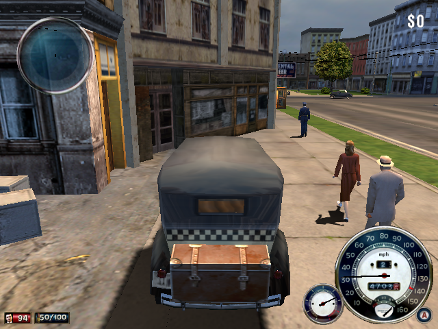

# The Familia

**Beta.** *Mafia: The City of Lost Heaven* (PC, 2002, version 1.2) running natively
on ARM64 Linux handhelds through PortMaster. The game's own x86 code (Game.exe and
the LS3D engine DLLs) is statically recompiled to ARM64. Direct3D 8 runs on
OpenGL ES 3.2, DirectSound and DirectInput run on SDL2, and the game's videos play
through a small bundled FFmpeg.

Tested on the **Anbernic RG40XX H** (Allwinner H700, Mali-G31) with muOS.
Other PortMaster devices with 64-bit (AArch64) firmware and OpenGL ES 3.2 may work,
but they are untested.

> **This repository and its releases contain no game files.** You need your own
> copy of Mafia. The prebuilt release is provided **for testing purposes only**.

## Performance (RG40XX H)

| Scene | FPS |
|---|---|
| Menus | 60 |
| Videos | 25 (their native rate) |
| Cutscenes | 57–60 |
| Daytime driving | 24–30 |
| Free Ride, maximum traffic and pedestrian density | 27–28 |
| Night missions (hundreds of street lights) | 26–28, short dips into the low 20s |

Expect brief hitches when the game streams in a new part of the city or loads
something for the first time, such as a car's first crash. For the smoothest play,
keep **Options → Video → Shadows** at **Very Low** (the default on a new install).
Lowering draw distance, LOD and traffic density helps further.
A full playthrough has not been verified yet.

## Quick start

1. Download `the_familia.zip` from
   [Releases](https://github.com/rzrbld/TheFamilia/releases) (see
   [which download](#which-download) below). Copy
   **`The Familia.sh`** into your Ports launcher folder (on muOS, `ROMS/Ports`) and
   the **`the_familia`** folder into `ports` on the same SD card.
2. Put your own game files into `ports/the_familia/source/` (any letter case):
   - the three Mafia CDs as `.bin` + `.cue` or `.iso` images;
   - the official English patch `mafia_patch_1.2_eng.exe`;
   - an unprotected 1.2 `Game.exe`, loose or in a `.zip`, `.rar` or `.7z`. The
     retail Game.exe is SafeDisc-protected and cannot be recompiled.
3. Start **The Familia** from the Ports menu. The first start imports the game
   (about 2 GB, several minutes; keep the handheld charged). You can delete
   `source/` afterwards.
4. The launcher opens. Set the FPS counter, frame limit, look sensitivity, CPU
   mode, 32- or 16-bit textures and GPU streaming, or view the controller layout,
   then choose **Save and run**.

**GPU streaming** (off by default) is about 2 FPS faster, but on the H700's GPU
driver it makes the driver's memory grow for as long as you play: on a 1 GB
handheld the game slows down after a while and can freeze within an hour. Turn it
on only for short sessions.

The game reads the controller as its own gamepad. PortMaster's gptokeyb2 presents
any handheld's buttons as a standard Xbox 360 pad, so the layout is the same
everywhere. On foot and in the car have separate layouts, like the console
versions:

| Button | On foot | In the car |
|---|---|---|
| Left stick | move | steer |
| Right stick | look, aim | look around |
| RT / LT | fire / sniper mode | accelerate / brake, reverse (analog) |
| A | confirm in menus | confirm in menus |
| B | reload | speed limiter |
| X | jump | handbrake |
| Y | use, get in a car | get out |
| LB / RB | inventory / crouch | look left / right |
| L3 / R3 | run or walk / objectives | horn / camera |
| D-pad | next and previous weapon, holster, drop | gear up and down, manual gears |
| Select / Start | city map / pause menu | city map / pause menu |

Rebind any of it in the game's **Options → Controls** (player and car pages,
second column). The same menu has aiming sensitivity for X and Y and mouse
inversion. The launcher's **Look sensitivity** sets the right stick's base speed.

Everything the port writes stays in `ports/the_familia/`: saves and settings in
`conf/`, the log in `log.txt`. Keep `conf/` when updating, and attach `log.txt`
when you report a problem.

### Which download

Releases come in two builds of the same code:

| Download | Built with | For |
|---|---|---|
| `the_familia.zip` | profile-guided optimisation (PGO), trained on an H700 | H700 handhelds (RG40XX, RG35XX series); start here on any device |
| `the_familia-nopgo.zip` | the same compiler options without the profile | testing on faster handhelds (RK3566/RK3568 and up) |

PGO lays the code out by how often each part runs on the H700, which makes it
about 10% faster there. On other CPUs that layout may help less or not at all;
the non-PGO build is there to compare. Both contain the same features and use the
same saves and settings, so you can switch by extracting the other one over your
install.

## Building

See [docs/BUILDING.md](docs/BUILDING.md). The build translates your own copy of the
game's executables, so the generated code is not part of this repository.
[docs/ARCHITECTURE.md](docs/ARCHITECTURE.md) describes how the port works.

## License and acknowledgements

This project's own code is under the [MIT license](LICENSE). Third-party
components keep their own licenses; see [THIRD_PARTY.md](THIRD_PARTY.md).

Thanks to **Illusion Softworks** for creating Mafia;
[PCRecomp](https://github.com/sp00nznet/pcrecomp) for the x86 lifter and Win32
runtime; [mafia-re](https://github.com/Marvisak/mafia-re) for its map of the
engine's function names and structures; and PortMaster, SDL, FFmpeg and Xiph.Org.

*Mafia* and its code, artwork, audio and trademarks belong to their respective
rights holders. This project is unofficial and is not affiliated with or
endorsed by them. The MIT license does not cover the original game or its
translated code. Users must supply their own game files.
